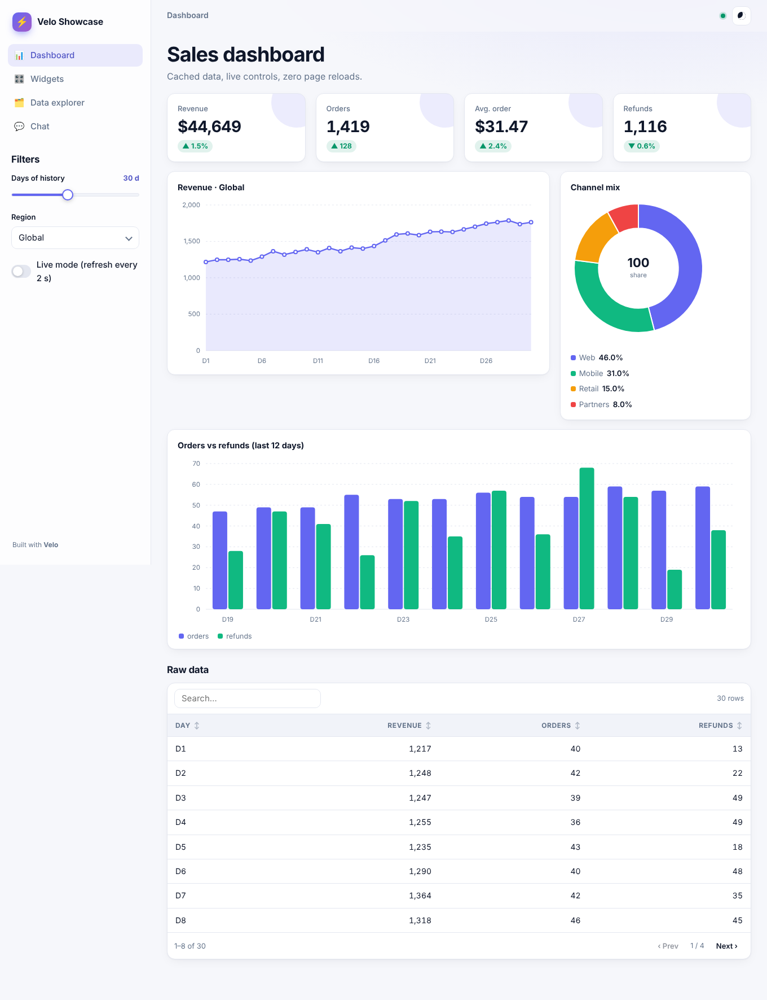
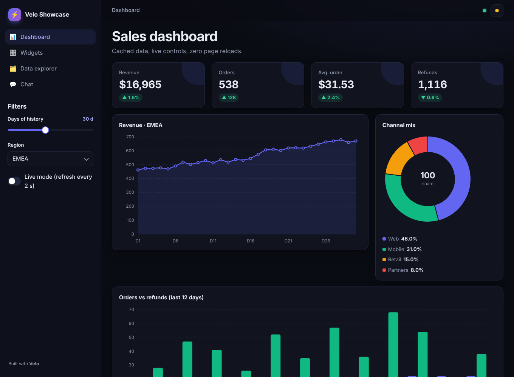
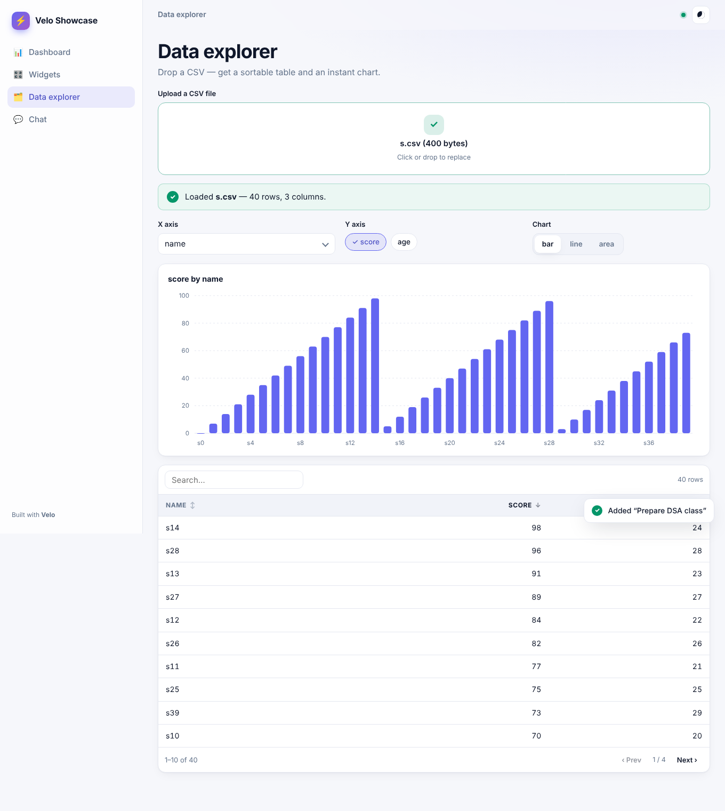

# ⚡ Velo

[](https://github.com/rafay183/velo/actions/workflows/tests.yml)
[](https://pypi.org/project/velo-ui/)
[](#)
[](LICENSE)
[](#)

**Beautiful, reactive Python web apps in minutes. Zero dependencies.**

Velo lets anyone turn a Python script into a polished web app, with dashboards, forms, data tools and chat UIs. It runs on your laptop and deploys anywhere with one command. The whole framework is about 140 KB of pure-stdlib Python plus a 16 KB (gzipped) client.

```python
import velo

app = velo.App("Hello", accent="#6366f1")

@app.page("/")
def home(ui):
    name = ui.input("Your name", placeholder="Ada")
    n = ui.slider("How excited?", 1, 10, 7)
    ui.title(f"Hello {name or 'world'}" + " 🎉" * n)

app.run()
```

```bash
python app.py          # or:  velo run app.py
```



<p> </p>

---

## Why Velo?

| | **Velo** | Typical script-rerun frameworks |
|---|---|---|
| Install size | **0 dependencies**, ~140 KB | Dozens of transitive packages |
| What re-runs on a click | **Only the page function** | Often the whole script |
| UI updates | **DOM morphing**: no flicker, focus and caret kept | Partial or full re-paint |
| Hot reload | **Keeps your state** (widgets and `ui.state` survive a save) | Session usually resets |
| Syntax error while editing | Overlay in the browser; app keeps running | Varies |
| Tables | Built-in search, sort and paging on the client | Varies |
| Charts | Built-in SVG line, area, bar and donut with tooltips, no deps | Usually needs a plotting library |
| Typing in inputs | Debounced; sliders throttled | Often one round trip per change |
| Live push from Python | `app.push()` from any thread (SSE) | Limited |
| Deploy | `velo docker` (vendors itself), honours `$PORT` | Extra setup |
| Theme | Light and dark with a toggle; one accent colour themes everything | Config files |

---

## Install

```bash
pip install velo-ui
velo new myapp && cd myapp && velo run app.py
```

Needs Python 3.9+. Nothing else.

---

## The 60-second tour

### Pages and navigation
Two or more pages give you an automatic sidebar nav with client-side routing.

```python
@app.page("/", title="Dashboard", icon="📊")
def dashboard(ui): ...

@app.page("/settings", title="Settings", icon="⚙️")
def settings(ui): ...
```

### Widgets return values
```python
name   = ui.input("Name", placeholder="…")          # also: type="password" | "email"
bio    = ui.textarea("Bio", rows=4)
age    = ui.number("Age", 30, min=0, max=120)
level  = ui.slider("Level", 0, 100, 50, suffix="%")
city   = ui.select("City", ["Karachi", "Lahore"])    # returns the object, any type
plan   = ui.radio("Plan", ["Free", "Pro", "Team"])   # segmented control
tags   = ui.multiselect("Tags", ["a", "b", "c"])     # chips
ok     = ui.checkbox("I agree");  dark = ui.toggle("Dark mode")
day    = ui.date("Start");        col  = ui.color("Brand", "#6366f1")
f      = ui.upload("CSV file", accept=".csv")        # UploadedFile(.name .data .text())
if ui.button("Save", icon="💾"): ...                 # True on the click run
ui.download("Export", data, "report.csv")
```

### State and callbacks
```python
@app.page("/")
def counter(ui):
    ui.init(count=0)                        # defaults, set once per browser session

    def add(step):
        ui.state.count += step

    with ui.row():
        ui.button("−", on_click=add, args=(-1,), kind="secondary")
        ui.button("+", on_click=add, args=(1,))
    ui.metric("Count", ui.state.count)
```
Callbacks run **before** the re-render, so the page always shows consistent state. Use `ui.get("key")` and `ui.set("key", v)` to read or write any widget that has a `key=`.

### Layout
```python
a, b, c = ui.columns(3)               # or ui.columns([2, 1])
a.metric("Revenue", "$12.4k", "+8%")  # containers proxy every component…
with b.card("Settings", "Optional subtitle"):   # …or use `with`
    ui.toggle("Enabled")
t1, t2 = ui.tabs(["Chart", "Data"])   # tabs switch instantly on the client
with ui.expander("Advanced"): ...
with ui.sidebar: ui.select("Region", [...])
with ui.row(): ...                    # horizontal button group
```

### Data and charts (pandas optional)
```python
ui.table(df)                                       # DataFrame, list of dicts, dict of lists…
ui.line_chart(df, x="date", y=["sales", "cost"])
ui.area_chart(rows, x="day", y="revenue", title="Revenue")
ui.bar_chart(rows, x="day", y=["a", "b"], stacked=True)
ui.pie_chart({"k": ["A", "B"], "v": [60, 40]})
ui.metric("Users", 1520, delta=-12, inverse=True)  # inverse: down is good
```

### Text and feedback
`ui.title`, `ui.header`, `ui.subheader`, `ui.text`, `ui.caption`, `ui.markdown` (safe), `ui.code`, `ui.json`, `ui.badge`, `ui.link`, `ui.image` (URL, path, bytes or PIL), `ui.progress`, `ui.info`, `ui.success`, `ui.warning`, `ui.error`, `ui.toast`, `ui.divider`, `ui.html` (trusted).

### Chat apps
```python
ui.init(msgs=[])
if q := ui.chat_input("Ask me…"):
    ui.state.msgs += [("user", q), ("assistant", my_llm(q))]
for role, text in ui.state.msgs:
    ui.chat_message(role, text)
```

### Speed tools
```python
@velo.cache(ttl=300)          # shared across sessions, TTL + LRU
def load_data(path): ...

ui.autorefresh(5)             # live dashboards: re-run every 5 s while visible
app.push()                    # from a background thread: refresh all open browsers
app.push(ui.session_id)       # …or just one
ui.rerun(); ui.navigate("/other")
```

---

## Deploy

```bash
velo run app.py --prod          # 0.0.0.0, no reload, no tracebacks, gzip on
velo docker app.py              # writes Dockerfile and vendors velo
docker build -t myapp . && docker run -p 8000:8000 myapp
```

Velo reads `$PORT` and `$VELO_HOST`, so the same app runs unchanged on Render, Railway, Fly.io, Cloud Run, Koyeb, Heroku or a VPS. `/health` is there for load balancers. Behind nginx, turn off buffering for `/api/stream` (Velo already sends `X-Accel-Buffering: no`).

## CLI

| Command | What it does |
|---|---|
| `velo run app.py [--port N] [--host H] [--open] [--prod] [--no-reload]` | Run an app |
| `velo new NAME` | Scaffold a starter app |
| `velo docker [app.py] [--port N]` | Generate a Dockerfile and vendor Velo |
| `velo version` | Print the version |

## How it works

1. The browser opens one SSE stream (used for hot reload and server push) and sends small JSON events (`set`, `click`, `submit`) to `/api/render`.
2. The server applies the event to that browser's session, runs callbacks, then re-runs **only the page function**. That builds a compact component tree.
3. The client morphs the live DOM to match the tree. Unchanged nodes aren't touched, so focus, caret, scroll position, open tabs and table sort all survive.
4. When you save a file, the reloader re-executes your module, swaps the page functions into the running app and tells browsers to re-render. Sessions stay where they were.

## Customising the look

Pass `App(accent="#10b981", theme="dark", wide=True, icon="🚀")`, or override any CSS variable (`--accent`, `--radius`, `--font`…) with `ui.html("<style>:root{--r:6px}</style>")`.

## Current limits

- Sessions live in memory: use one process per app, or sticky sessions if you scale out.
- Uploads travel as base64 JSON (practical up to roughly 25 MB).
- No streaming of partial output inside a single run yet. For long jobs, use a background thread with `app.push()`.

## Testing

```bash
python -m pytest -q        # or: python tests/test_velo.py
```

## Contributing

Contributions are very welcome. Start with [CONTRIBUTING.md](CONTRIBUTING.md), pick a **good first issue**, and say hi in Discussions. Please follow the [Code of Conduct](CODE_OF_CONDUCT.md).

MIT licensed. © 2026 Muhammad Rafay Shaikh
